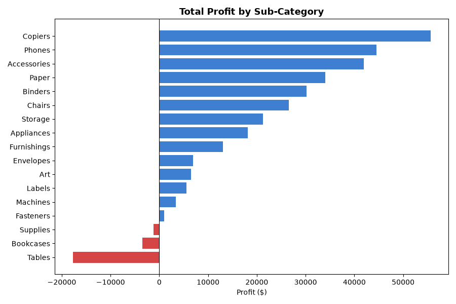
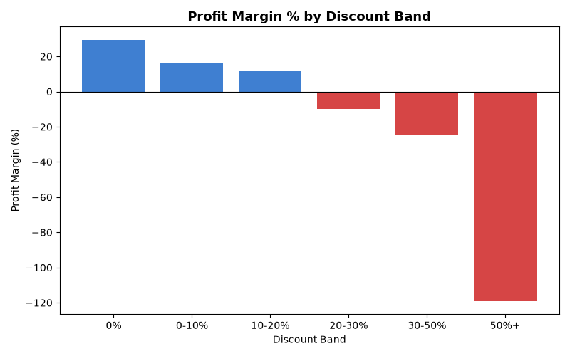
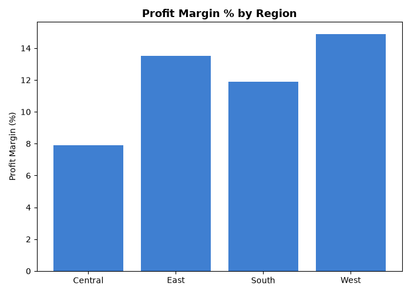

# Superstore Profitability Diagnostic

**TL;DR:** Sales are growing, but discounts above 20% flip orders from
profitable to loss-making (margin drops from +30% to -119%), and three
product sub-categories lose money outright. Full breakdown and
recommendation below.

## Business question Sales are healthy at $2.3M across the dataset, but is
the company actually converting that top-line growth into profit — and if
not, where exactly is it leaking?

## Approach
Using order-level retail transaction data (9,994 orders, Sales/Discount/
Profit by Sub-Category and Region), I ran a profitability cut across three
dimensions — product sub-category, discount level, and region — to isolate
where margin is being destroyed rather than just where revenue is being made.

Tools: SQL-style aggregation via pandas `groupby`, matplotlib for
visualization.

## How to run it
```bash
pip install -r requirements.txt
python analysis.py
```
Charts are regenerated into `charts/`; summary tables print to console.

## Key Findings

**1. Three sub-categories are losing money outright.**
Tables (-$17.7K, -9% margin), Bookcases (-$3.5K), and Supplies (-$1.2K) all
have negative total profit — meaning every unit sold in these lines makes
the business worse off, regardless of discounting.



**2. Discounting past 20% turns profitable orders into losses.**
Orders with 0% discount run a healthy 30% margin. That collapses to -10% at
20-30% discount, and craters to -119% margin at 50%+ discount. The
correlation between discount and profit is negative (-0.22) — discounting
is not a neutral growth lever here, it's actively eroding the bottom line.



**3. Tables + high discounting is the single worst combination.**
Filtering to orders with 20%+ discount, Tables alone accounts for -$31K in
losses — the single biggest profit leak in the dataset.

**4. Regional margins vary meaningfully.**
West (15%) and East (14%) run healthy margins; Central lags at 8%, despite
comparable sales volume — suggesting a discounting or cost-structure issue
specific to that region, not a demand problem.



## Recommendation
- **Cap discounts at 20%** on Tables and Bookcases specifically, or
  re-price them — the current strategy is subsidizing every sale.
- **Investigate Central region's discount policy** — its margin gap versus
  West/East isn't explained by sales volume, so it's likely a controllable
  pricing or approval-process issue.
- **Protect Copiers, Phones, and Accessories** — these carry the highest
  absolute profit and healthy margins; growth investment should be aimed
  here, not at discount-driven categories.

## Files
- `superstore.csv` — source data
- `analysis.py` — reproducible analysis (run `python analysis.py`)
- `charts/chart1_profit_by_subcategory.png`, `charts/chart2_margin_by_discount.png`,
  `charts/chart3_margin_by_region.png` — supporting visuals

## Data source
Sample Superstore retail dataset (public, commonly used for BI/analytics
training).